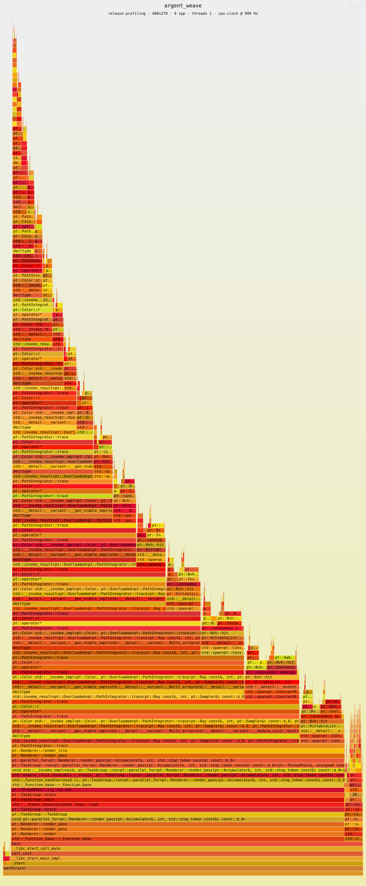

# Profiling

Where the renderer's time goes, how that was measured, and how to measure it
again. The recorded distribution below is what every later optimisation is
argued against: a change that does not move one of these numbers has not been
shown to do anything.

This is a sampling profile, not a timing measurement. Timings and the workload
they use are in [benchmarks.md](benchmarks.md); this document explains them
rather than adding to them.

## Prerequisites

`perf` and a flame graph renderer, neither of which the build needs — they are
developer tools, installed per machine.

### perf

```bash
sudo apt install -y linux-tools-common "linux-tools-$(uname -r)"
sudo sysctl kernel.perf_event_paranoid=2
```

The package built for the running kernel provides `perf`; nothing else is
needed for user-space sampling.

Ubuntu's kernel adds a level 4 to `kernel.perf_event_paranoid` and ships with
it: no unprivileged process may open a performance event at all, so `perf
record` fails outright. Level 2, the upstream default, permits profiling one's
own user-space processes and forbids resolving kernel symbols, which is what
these profiles need — the workload is pure computation, and kernel time
appears as unresolved addresses rather than named frames. It is lowered for
the session rather than in `/etc/sysctl.d`, so it returns to 4 at the next
boot: a system-wide security setting stays relaxed only while it is in use.

### The flame graph renderer

```bash
cargo install inferno --locked
```

`inferno` is a Rust port of the original FlameGraph scripts. It is preferred
here because it installs as a binary rather than a checked-out repository of
Perl scripts, and the toolchain to build it is already required by
`scene-tool`. Install it from outside `tools/scene-tool`, or its
`rust-toolchain.toml` pin will be applied to a tool that has nothing to do with
that crate.

Recorded with: `perf` 7.0.14, `inferno` 0.12.8.

### What is sampled

The event is `cpu-clock`, a software timer, at 999 Hz. The frequency is not a
round 1000 so that sampling cannot phase-lock with kernel timers and resample
the same point in a periodic loop.

Hardware counters are available on this host — `cycles`, `instructions` and
`cache-misses` all return figures — but they are not what these
profiles use. The question here is where wall time goes. Counting cycles
answers a different question and belongs with the work that asks it.

## The build

Profiles are taken from `release-profiling`, never from `release` or
`release-stats`.

`release-profiling` inherits `release` — same `-O3`, same ThinLTO, same scalar
type — and adds two flags:

- `-g` emits DWARF without changing code generation. It is what makes inlined
  code visible: most of the hot path lives in headers, and without debug
  information `Aabb::intersect` and the `Vec3` operators disappear into
  whichever function inlined them.
- `-fno-omit-frame-pointer` keeps the frame pointer so stacks can be unwound
  cheaply. This one does change code generation.

Profiling `release` directly does not work. Its stacks terminate at the first
frame — `Bvh::hit` followed by address zero — because the frame pointer is gone,
and a flame graph cannot be built from stacks of depth one.

`RelWithDebInfo` is not used either, and the preset that offered it was removed.
It builds at `-O2` without LTO, so its inlining decisions differ from the build
whose timings are on record. A profile of a different binary is not an
explanation of these numbers.

### What the extra flags cost

Measured under WSL2 with `Float = double`, before the current baseline, on
three scenes at their benchmark settings, three runs each, minimum reported:

| Scene | `release` | `release-profiling` | Change |
|---|---|---|---|
| `gilded_orrery` | 9.298 s | 9.074 s | −2.4% |
| `cornell_smoke` | 12.058 s | 12.350 s | +2.4% |
| `earth` | 7.928 s | 8.123 s | +2.5% |

One scene came out faster, which a frame pointer cannot cause; the spread across
`gilded_orrery`'s own three runs was 5.8%, wider than the effect being looked
for. The honest reading is that the cost was not resolved and is smaller than
this machine can see. It is recorded rather than resolved because the number
feeds no decision: `release-profiling` is not a timing build, and no figure from
it appears in [benchmarks.md](benchmarks.md).

## Taking a profile

```bash
cmake --preset release-profiling
cmake --build --preset release-profiling
taskset -c 2 scripts/profile.sh
```

The workload is `benchmarks/manifest.txt`, unchanged. A profile taken at a
different resolution or sample count cannot explain a timing taken at these
ones. A single scene, or several:

```bash
taskset -c 2 scripts/profile.sh gilded_orrery cornell_smoke
```

Profiles run on one thread unless `--threads` says otherwise, pinned to the
same core as a one-thread timing for the reason given in
[benchmarks.md](benchmarks.md#method). A single-threaded profile shows the
render loop itself. On more threads `perf` folds every worker into the same
graph, and the pool's scheduling and waiting frames appear beside the work. The
output names do not carry the thread count, so a profile taken at another one
belongs in its own directory:

```bash
scripts/profile.sh --threads 16 --out out/profiles-16t argent_weave
```

Four files land in `out/profiles/` per scene:

| | |
|---|---|
| `<scene>.data` | The raw `perf` record. Kept so a profile can be re-examined without re-running it. |
| `<scene>.folded` | Identical stacks folded into counts. Small, and the file a later comparison would diff. |
| `<scene>.svg`, `<scene>-reversed.svg` | Flame graphs, forward and leaf-merged. |
| `<scene>.txt` | Flat self-time ranking, entries above 0.5%. |

## Reading the output

**Start with the flat ranking.** `<scene>.txt` answers "which function do I open
first" in one screen. It is produced with `-g none`: the integrator recurses to
the scene's maximum depth, and without that flag the same call chain repeats
down the page and buries everything else.

**The forward flame graph shows how time was reached**, the reversed one shows
what it was spent on. Both come from the same folded file, so neither costs an
extra measurement. In a recursive tracer the reversed graph is usually the
readable one: a function reached at twelve recursion depths appears once instead
of as twelve thin stripes.

**Recursion can also be collapsed in the forward view**, which keeps the call
structure while merging repeated frames:

```bash
inferno-collapse-recursive out/profiles/gilded_orrery.folded \
    | inferno-flamegraph > out/profiles/gilded_orrery-collapsed.svg
```

**For anything inlined, go to source lines.** A function that only exists in a
header has no symbol of its own, and its cost is reported against whatever
inlined it:

```bash
perf report --input out/profiles/gilded_orrery.data --stdio \
    --no-children -g none --sort srcline --percent-limit 1
```

This is how the slab test below was separated from the rest of BVH traversal.
Line attribution under `-O3` is approximate — instructions are scheduled across
statement boundaries — so read a cluster of adjacent lines together rather than
trusting a single one.

## The recorded distribution

Taken 2026-10-15 on the reference machine described in
[benchmarks.md](benchmarks.md): i7-11700K, native Linux, Clang 18.1.3,
`Float = float`, from the source the baseline there was measured at. One
thread pinned to logical CPU 2, one render per scene at manifest settings,
between 5,700 and 13,600 samples each, on an otherwise idle machine. It
replaces a distribution taken under WSL2 with `Float = double`, before the
intersection arithmetic was made robust; that one is in the file's history.

The profile covers the whole process, so scene loading and tree construction
sit inside it. For every scene but `argent_weave` that is noise; there
`BvhBuilder::build_recursive` is 2.9% of the profile and the OBJ parser about
1%, against a timed record that keeps construction outside the measurement
entirely.

Heaviest three entries per scene, by self time:

| Scene | | | |
|---|---|---|---|
| `argent_weave` | `Bvh::hit` 80.4% | `MeshTriangle::hit` 4.7% | `intersect_triangle` 4.3% |
| `neon_cathedral` | `Bvh::hit` 68.3% | `Quad::find_hit` 9.8% | `Sphere::hit` 3.3% |
| `gilded_orrery` | `Bvh::hit` 68.0% | `Quad::find_hit` 12.1% | `Quad::hit` 3.1% |
| `random_spheres` | `Bvh::hit` 67.7% | `Sphere::hit` 14.0% | `acosf` 2.9% |
| `mesh_showcase` | `Bvh::hit` 48.7% | `intersect_triangle` 10.2% | `Instance::hit` 5.5% |
| `quads` | `Bvh::hit` 43.5% | `Lambertian::scatter` 11.9% | render loop 10.4% |
| `cornell_box` | `Bvh::hit` 41.7% | `Quad::find_hit` 9.3% | `Sphere::hit` 8.2% |
| `showcase` | `Bvh::hit` 41.6% | `Sphere::hit` 22.0% | `acosf` 9.8% |
| `checkered_spheres` | `Sphere::hit` 28.9% | `Bvh::hit` 21.8% | `CosinePdf::value` 8.3% |
| `earth` | `Sphere::hit` 27.9% | `Bvh::hit` 19.4% | render loop 10.9% |
| `area_lights` | `Perlin::noise` 25.1% | `Sphere::hit` 18.7% | `Bvh::hit` 17.6% |
| `cornell_smoke` | `Quad::find_hit` 41.5% | `Bvh::hit` 17.5% | `Quad::hit` 9.6% |
| `perlin_spheres` | `Perlin::noise` 28.2% | `Sphere::hit` 19.1% | `Bvh::hit` 12.7% |

The render loop is described under
[Shading is not always the small half](#shading-is-not-always-the-small-half).



Six flame graphs are kept in `profiles/`, one per regime the set contains:
`argent_weave` (dense traversal, a single deep tree), `gilded_orrery`
(traversal, nested trees), `cornell_smoke` (volumetric), `perlin_spheres`
(texture evaluation), `showcase` (mixed), and a reversed view of
`gilded_orrery`.

### The slab test is the hottest code in the engine

Source lines of `aabb.hpp`, the slab test inlined into `Bvh::hit`, as a share
of the whole run:

| Line | | `gilded_orrery` | `argent_weave` |
|---|---|---|---|
| `aabb.hpp:84` | narrow `ray_t.max` | 14.0% | 15.1% |
| `aabb.hpp:75` | swap on the sign of the reciprocal | 11.8% | 11.8% |
| `aabb.hpp:67` | `t_far` from the reciprocal | 5.2% | 11.6% |
| `aabb.hpp:88` | empty-interval rejection | 5.1% | 5.1% |
| `aabb.hpp:66` | `t_near` from the reciprocal | 4.3% | 5.1% |
| `aabb.hpp:83` | narrow `ray_t.min` | 2.0% | 1.8% |
| `aabb.hpp:82` | widen `t_far` | 1.2% | below 1% |
| `aabb.hpp` | unattributed | 10.7% | 11.9% |

The slab test is 54% of `gilded_orrery` and 62% of `argent_weave`, against 39%
and 51% in the previous distribution. The scenes do not test more boxes than
they did — the traversal counters did not move — but each test costs more: the
exit distance is now widened by `1 + 2γ₃` to keep the test conservative, which
adds a multiply to the chain every box test waits on.

Lines 83 and 84 have the same shape and differ seven- to eightfold. The
asymmetry predates the widening — the previous distribution showed it on the
same two statements — so the widening does not explain it, though it lengthens
the chain line 84 waits on. A sampling profile charges a stall to the
instruction that is waiting when the sample is taken, not to the one that will
produce the value, and which source line that is follows from how the compiler
scheduled the loop. That reading is a hypothesis; confirming it needs the
disassembly or hardware counters rather than a time profile.

### Most traversal happens one tree down

`gilded_orrery` builds seventeen trees and `argent_weave` seven. In both, the
geometry that matters sits in a tree below the scene's own: a mesh or an
instance is one leaf of the top-level tree, and reaching its triangles starts a
fresh traversal of a separate tree, with its own root test and its own stack.
Samples taken with `Bvh::hit` on the stack twice or more — inside a tree
entered from another tree's leaf — are 58.6% of `gilded_orrery` and 84.4% of
`argent_weave`. The previous distribution reported 23.9% for `gilded_orrery`
under a different definition; the two figures are not comparable.

### Two indirections show up on their own lines

Two lines outside the slab test are worth naming, both in `argent_weave`,
because both are dispatch rather than arithmetic.

`bvh.cpp:363` carries 3.7%. It is the `prim->hit()` call inside `hit_leaf`:
a virtual call through a `const Hittable*`, issued once per primitive the
traversal reaches. The leaves of this scene hold roughly one primitive each,
so that is one indirect call per leaf visited.

`mesh.hpp:82` carries 2.5%, one line of `Mesh::triangle`, which reads a vertex
position through the index buffer. A triangle is a `(Mesh*, index)` handle, so
fetching its three corners is two dependent loads per corner into two separate
arrays.

Both carry a smaller share than in the previous distribution, 5.1% and 4.0%,
because the slab test around them grew; the work they do did not change.

### The volumetric scene barely touches its tree

`cornell_smoke` spends 41.5% of its time in `Quad::find_hit`, and 9.6% more in
`Quad::hit`, while holding an eleven-node tree.
`ConstantMedium::sample_interaction` issues two unbounded `hit` calls against
its boundary per ray segment, the boundary is a box of six quads behind a list,
and the integrator tests every medium in the scene on every segment regardless
of where the ray goes.

### Transcendental functions are a visible fraction

`showcase` spends 16.5% in `acosf`, `atanf` and `atan2f`; `checkered_spheres`
15.5% across those and `sinf` and `cosf`; `earth` 14.1%. The sources are
`get_sphere_uv`, which calls `atan2f` and `acosf` on every sphere hit — `atanf`
is the core `atan2f` calls into — and cosine sampling, which calls `sinf` and
`cosf` on every diffuse bounce. `acosf` alone is the largest of them in every
scene that uses it.

These run in glibc, which picks an implementation at run time for the CPU it
finds. On this machine `sinf` and `cosf` resolve to variants that use fused
multiply-add, although the renderer itself is built for a baseline without it.
Results that pass through these functions are therefore the same on two
machines only if both select the same variant, and the counter gate's
agreement between this machine and the CI runner rests on that as well as on
the shared compiler and library.

### Shading is not always the small half

`Perlin::noise` alone is 28.2% of `perlin_spheres` and 25.1% of `area_lights`
— more than traversal in both.

The render loop is the task `parallel_for` runs for a pass, with the per-sample
setup inlined into it: constructing a `Sampler`, generating the ray,
accumulating the result. It carries up to 10.9% of self time, on `earth` and
`quads`, where a sample costs least, and less than one percent where traversal
dominates. It is reported under a `std::function` symbol because the task is
type-erased, but that call happens once per participating thread and pass, not
once per sample.

### One scene now carries the traversal case

`argent_weave` was authored for this. It puts `Bvh::hit` at 80.4% and the slab
test alone above three fifths of the run, on a single tree of 2.3M nodes — see
[benchmarks.md](benchmarks.md) for its counters.

The rest of the set has not changed shape. Three of the other twelve scenes
put `Bvh::hit` above half the run; in most of the remainder the tree is too
small to matter. What is new is that a traversal result no longer has to
rest on `random_spheres`, `neon_cathedral` and `gilded_orrery`, whose trees
are two to four orders of magnitude smaller than the one an optimisation
will be aimed at.

## What invalidates a profile

- A different build preset. `release-profiling` is the only one these numbers
  come from; `release` cannot be unwound and `release-stats` carries counters in
  the traversal loop.
- A changed row in `benchmarks/manifest.txt`, or a changed scene file. Both make
  the profile describe work that is no longer being timed.
- A different scalar type.
- A different thread count. The recorded profiles are single threaded; a
  parallel one adds the pool's frames and changes how the cores share cache
  and memory bandwidth.
- A different machine. Only the reference machine is profiled.
- A busy machine. A sampling profile is a distribution, so interference shifts
  it rather than adding an obvious outlier the way a timing does. Light desktop
  load moved no entry of the recorded set by more than 1.3 points; heavier load
  was not measured.
- A re-framed camera on argent_weave. Its cost per ray query depends on
  how much of the frame the geometry covers, which is stated in
  [benchmarks.md](benchmarks.md).
